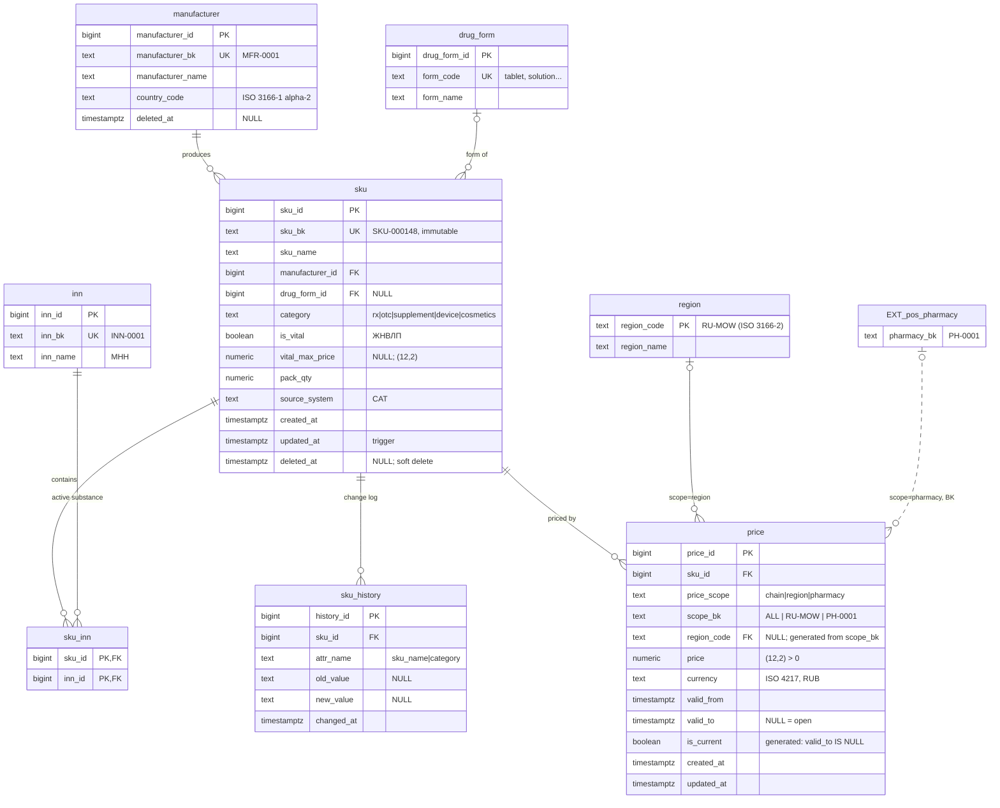

# catalog_service_db

Ключевые ограничения:
* `price`: `EXCLUDE USING gist (sku_id WITH =, price_scope WITH =, scope_bk WITH =,
  tstzrange(valid_from, valid_to, '[)') WITH &&)` — I5;
* `price`: `CHECK` на согласованность `price_scope` / `scope_bk`
  (`chain` ⇔ `'ALL'`, `region` ⇔ `^RU-`, `pharmacy` ⇔ `^PH-\d{4}$`);
* `sku.is_rx` не хранится — выводится как `category = 'rx'` ([ADR-0009](../adr/0009-is-rx-derived.md));
* `inn_name` в `v_sku` — `string_agg(inn_name, ' + ' ORDER BY inn_name)`, NULL для нелекарственных.
