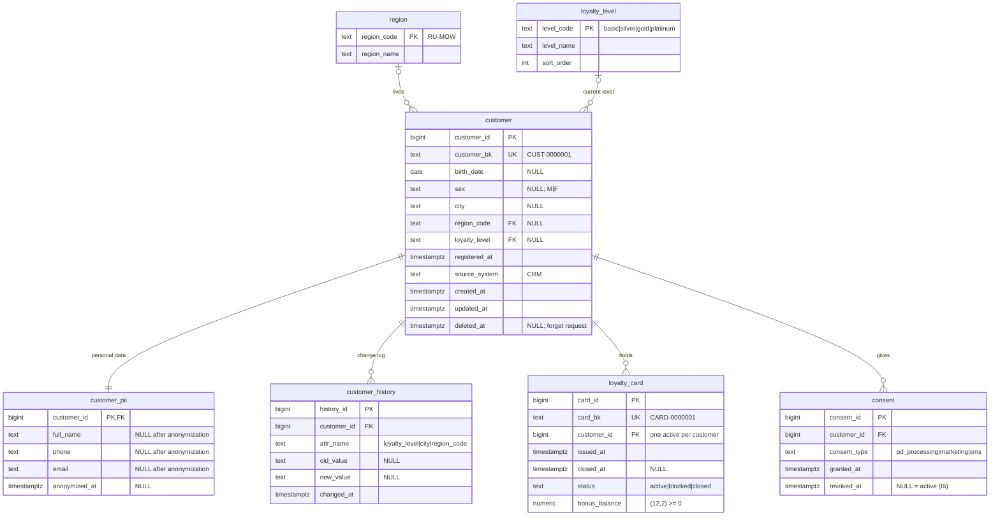

# crm_service_db

Ключевые ограничения:
* `loyalty_card`: partial unique `(customer_id) WHERE status = 'active'` — C22;
  `CHECK (closed_at IS NULL OR status <> 'active')` — C23;
* `consent`: partial unique `(customer_id, consent_type) WHERE revoked_at IS NULL` — I6;
* триггер: установка `customer.deleted_at` автоматически обезличивает `customer_pii`
  ([ADR-0008](../adr/0008-customer-forget.md));
* `v_customer.marketing_opt_in` = `EXISTS` активного согласия `marketing`, без `now()`;
* пользователь `checker` не имеет доступа к `customer_pii`.
