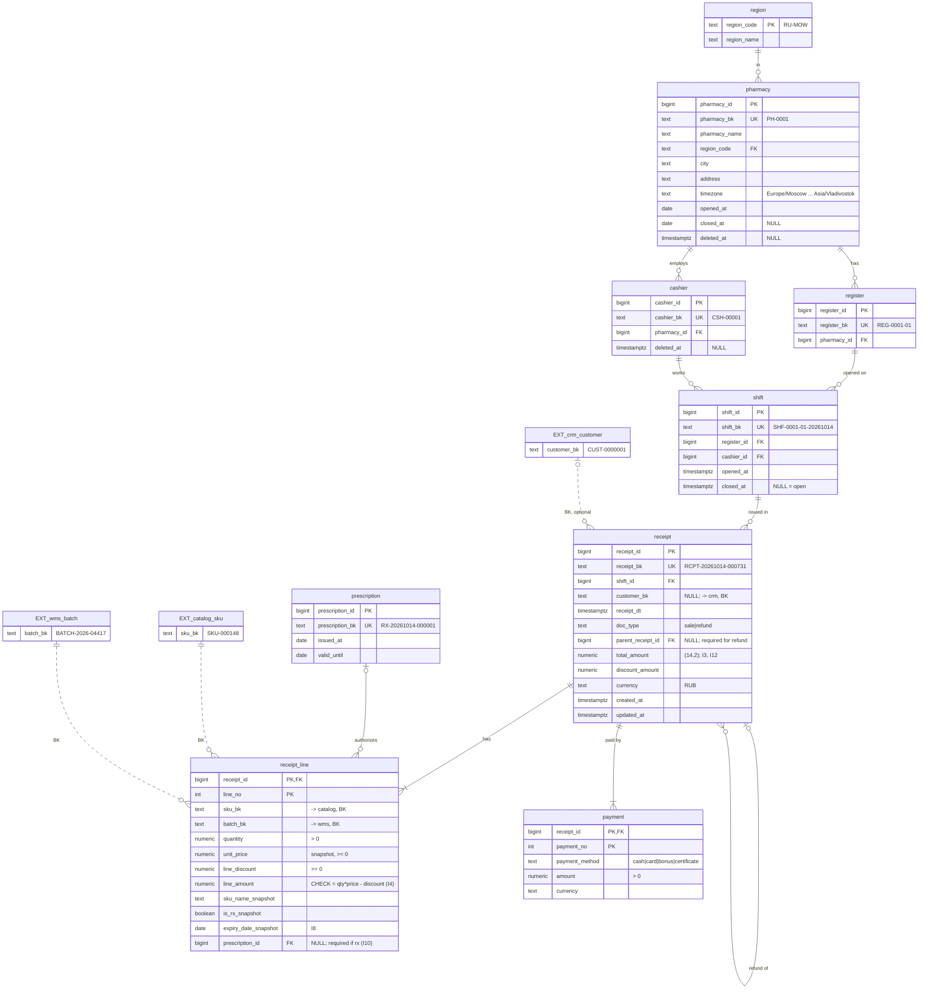

# pos_service_db

Ключевые ограничения:
* I3, I12 — `CONSTRAINT TRIGGER ... DEFERRABLE INITIALLY DEFERRED`;
* I4 — `CHECK` на `receipt_line` (`line_amount` — обычная колонка, не generated,
  иначе тест упадёт с `428C9`, а не `23514`);
* I8 — триггер: дата чека (по `timezone` аптеки) ≤ `expiry_date_snapshot`;
* I10 — `CHECK (NOT is_rx_snapshot OR prescription_id IS NOT NULL)`
  ([ADR-0005](../adr/0005-rx-prescription.md));
* I11 — триггер на строки возврата;
* `CHECK ((doc_type = 'refund') = (parent_receipt_id IS NOT NULL))` — C05;
* `v_receipt.prescription_bk` = `min(prescription_bk)` по строкам,
  `v_receipt.pharmacy_bk` / `cashier_bk` — через `shift → register / cashier`;
* `v_pharmacy` отдаёт **все** аптеки, включая закрытые (иначе C08).
