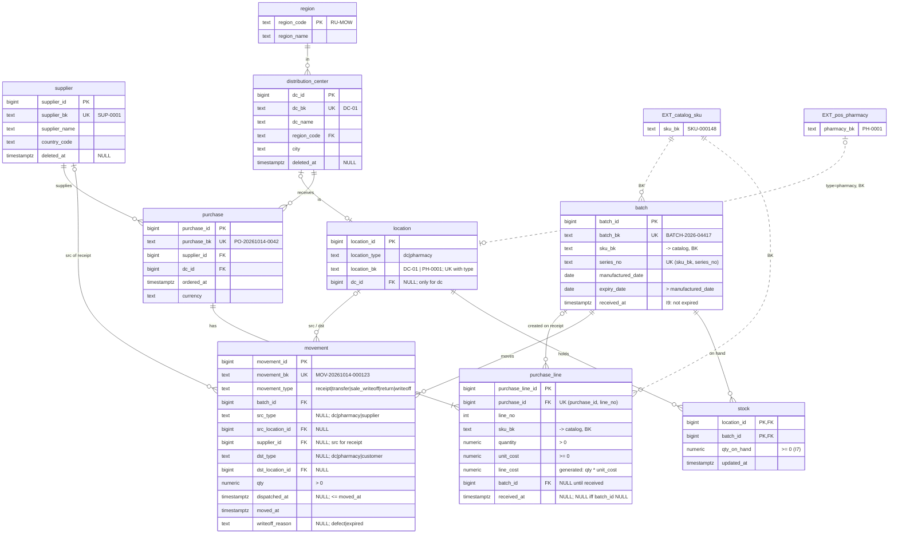

# wms_service_db

Ключевые решения:
* `location` — единая таблица локаций; аптеки в ней — справочная копия из POS по BK;
* `stock` материализован, обновляется триггером на `INSERT` в `movement`
  ([ADR-0004](../adr/0004-stock-materialized.md));
* продажи списываются дневным агрегатом `sale_writeoff` на (аптека, партия, день)
  ([ADR-0007](../adr/0007-sale-writeoff-daily.md));
* `return` = возврат поставщику (`src` = РЦ, `dst` = NULL); товар от покупателя
  в остаток не возвращается.
